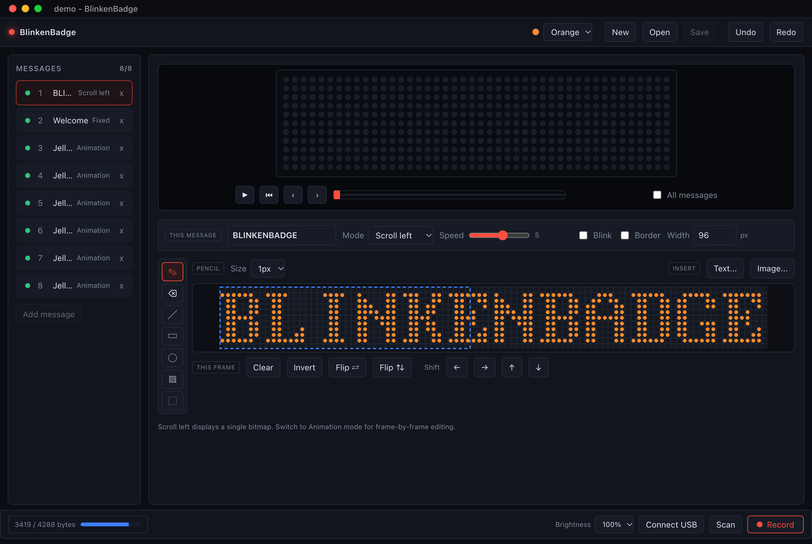
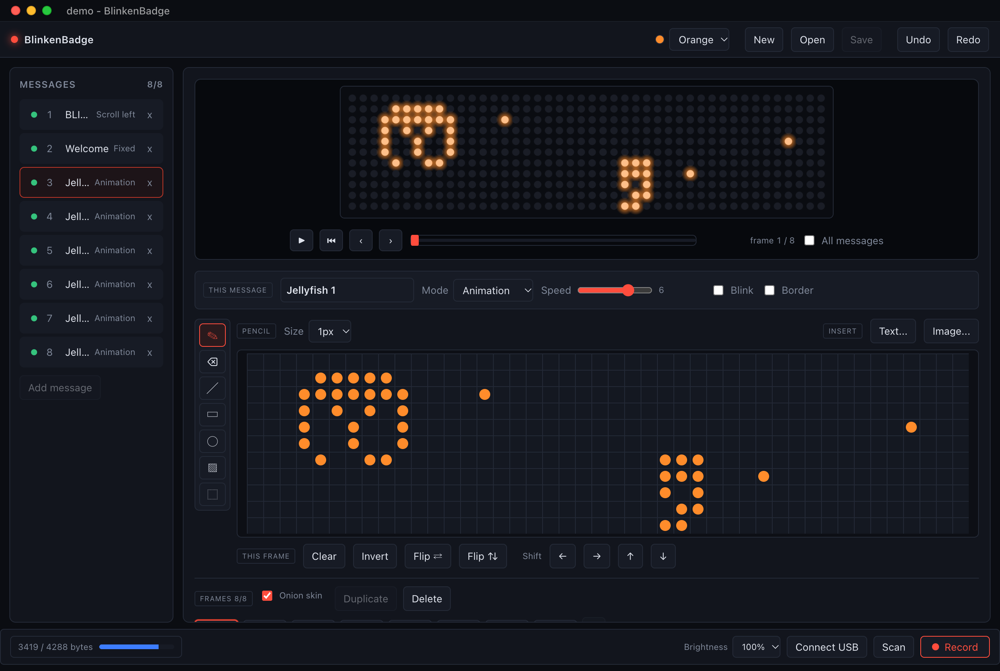

# BlinkenBadge

Editor for 44x11 monochrome LED name badges (WCH CH582). Uploads via USB HID and Bluetooth LE.

Compatible with stock firmware and [badgemagic](https://github.com/fossasia/badgemagic-firmware) firmware. No reflashing required. Runs on macOS, Windows, and Linux.





## Download

Prebuilt packages are available on the [Releases](../../releases) page.

| Platform | Package |
|---|---|
| macOS (Apple Silicon) | `BlinkenBadge_<version>_aarch64.dmg` |
| Windows | `BlinkenBadge_<version>_x64-setup.exe`, `.msi` |
| Debian, Ubuntu | `.deb` |
| Fedora, RHEL | `.rpm` |
| Linux (Portable) | `.AppImage` |
| Linux (Standalone Binary) | `.tar.gz` |

macOS builds are signed, notarized, and compiled for Apple Silicon (aarch64). Intel Macs require building from source.

Windows builds are signed with Microsoft Trusted Signing (Publisher: Martin Bogomolni).

Linux builds target glibc 2.35 or newer (Ubuntu 22.04+). The `.deb` and `.rpm` packages declare system dependencies automatically. The `.tar.gz` archive contains only the executable and requires system package `webkit2gtk-4.1`.

## Web Client

A web build of the editor runs in Chromium browsers via WebHID and Web Bluetooth.

Supported on Android via Chrome (Web Bluetooth only). Not supported on iOS due to lack of WebHID and Web Bluetooth in WebKit.

### Running Locally

1. Change directory:
   ```bash
   cd BlinkenBadge
   ```
2. Start the development server:
   ```bash
   npm run dev:web
   ```
3. Open `http://localhost:5180` in Chrome or Edge.

### Building for Production

1. Compile static assets:
   ```bash
   npm run build:web
   ```
2. Deploy the contents of `BlinkenBadge/dist-web/` to an HTTPS web server. WebHID and Web Bluetooth require a secure context.

See [web/README.md](web/README.md) for implementation details.

## Message Slots

The badge holds 8 message slots. Each slot stores 1 static bitmap or an animation of up to 8 frames. An upload contains up to 64 frames total across all 8 slots. The badge cycles enabled slots sequentially.

Disabled slots remain saved in the project but are excluded from the upload payload.

| Parameter | Values |
|---|---|
| Modes | Scroll Left, Scroll Right, Scroll Up, Scroll Down, Fixed, Animation, Snowflake, Picture, Laser |
| Speed | 1 to 8 (speed 6 = 250 ms/frame) |
| Effects | Blink, Animated Border |
| Brightness | 25%, 50%, 75%, 100% (global per upload) |
| Frame Width | 48 px (stock firmware) or 44 px (badgemagic firmware) |
| Frame Height | 11 px |
| Capacity | 8 frames per slot, 64 frames per upload |

## Drawing Tools

The editor includes pencil, eraser, line, rectangle, ellipse, flood fill, and rectangular selection (move, nudge, cut, copy, paste). Right-click erases with any active tool.

Images can be imported with an adjustable luminance threshold.

The canvas preview simulates badge playback speed and includes a scrub bar to inspect frames.

### Bitmap Fonts

Text tools stamp 11 px bitmap typefaces directly onto the canvas:

| Typeface | Description |
|---|---|
| Serif | Default blocky matrix face |
| Sans | Narrow proportional face |
| Cartoon | Rounded display face |
| Futuristic | Bold segmented face |

All typefaces cover basic Latin, Cyrillic, accented Latin, and 42 custom 11 px emoji glyphs. Typefaces can be mixed within a single bitmap.

Source artwork is defined in `fonts/*.face`. `fonts/build.py` compiles the Rust font tables and `web/fonts.json`. `fonts/derive.py` generates Cyrillic and accented glyphs from base glyphs.

## Connecting the Badge

### USB HID

1. Connect the USB cable between the computer and badge.
2. Verify the **USB** status indicator turns green in the transport bar.
3. Select **Record** to upload. Transfers complete in under 1 second.

On macOS and Windows, no driver configuration is required.

On Linux, configure udev permissions:
1. Copy the udev rule file:
   ```bash
   sudo cp 99-led-badge.rules /etc/udev/rules.d/
   ```
2. Reload rules:
   ```bash
   sudo udevadm control --reload-rules && sudo udevadm trigger
   ```
3. Disconnect and reconnect the USB cable.

### Bluetooth LE

Bluetooth is used when no USB cable is connected.

To initiate a Bluetooth transfer:
1. Disconnect the USB cable. The badge disables Bluetooth transmission while USB is connected.
2. Press button 1 on the badge. A Bluetooth icon appears on the matrix display when ready.
3. Select **Record** in the application.

The badge exits Bluetooth mode after each upload. Repeat step 2 before each subsequent upload.

Upload time is approximately 250 ms per 16-byte write (up to 70 seconds for a full 64-frame upload). Use USB HID for uploads approaching 64 frames to prevent timeouts.

### Open Firmware

Badges running [badgemagic](https://github.com/fossasia/badgemagic-firmware) firmware are recognized automatically over both USB HID and Bluetooth LE. Frame advance width is adjusted to 44 px (stock firmware uses 48 px).

The optional badgemagic Bluetooth PIN is not supported. To upload to a badge with a PIN enabled:
1. Connect via USB HID, or
2. Disable the PIN in the badge **SECURITY** menu.

## Documents

| Extension | Contents | Open Action |
|---|---|---|
| `.badge` | Full project (up to 8 message slots) | Replaces current document |
| `.badgemsg` | Single message slot | Inserts into current document |

Both formats use JSON and register system file associations.

Unsaved changes are autosaved to an application cache 2 seconds after each edit and removed on clean exit. If an abnormal exit is detected on launch, a restoration prompt is displayed.

## Keyboard Shortcuts

| Key | Action |
|---|---|
| `P` `E` `L` `R` `O` `F` `S` | Select tool: Pencil, Eraser, Line, Rectangle, Ellipse, Fill, Select |
| `Cmd/Ctrl` + `Z` / `Shift+Z` | Undo / Redo |
| `Cmd/Ctrl` + `C` / `X` / `V` / `A` | Copy / Cut / Paste / Select All |
| Arrow keys | Nudge selection, or jog preview |
| `Alt` + `Up` / `Down` | Reorder selected message slots |
| `Delete` | Erase selected pixels |
| `Esc` | Deselect |
| `Space` | Play or pause preview |
| `Cmd/Ctrl` + `N` / `O` / `S` | New / Open / Save |
| `Cmd/Ctrl` + `Shift` + `S` | Save As |
| `Cmd/Ctrl` + `Q` | Quit |

## Building

Prerequisites: Rust (stable) and Node.js 20.19+.

### Platform Dependencies

**macOS**
```bash
xcode-select --install
```

**Windows**
- Microsoft C++ Build Tools
- WebView2 Runtime

**Linux** (Debian / Ubuntu)
```bash
sudo apt install libwebkit2gtk-4.1-dev build-essential curl wget file \
  libxdo-dev libssl-dev libayatana-appindicator3-dev librsvg2-dev libudev-dev
```

### Build Steps

1. Install JavaScript dependencies:
   ```bash
   cd BlinkenBadge
   npm install
   ```
2. Start desktop application in development mode:
   ```bash
   npm run tauri dev
   ```
3. Run tests:
   ```bash
   npm test
   cd src-tauri && cargo test
   ```
4. Build installers:
   ```bash
   npm run tauri build
   ```
   Installers are generated in `BlinkenBadge/src-tauri/target/release/bundle/`. Cross-compilation is not supported.

### Creating a Release

Tagging a commit with `v*` triggers the release workflow in GitHub Actions. The git tag must match the version string in `package.json`, `src-tauri/Cargo.toml`, and `src-tauri/tauri.conf.json`.

1. Create a git tag:
   ```bash
   git tag -a v1.2.3 -m "BlinkenBadge 1.2.3"
   ```
2. Push the tag to GitHub:
   ```bash
   git push origin v1.2.3
   ```

To generate artifacts without publishing a release, trigger the **Release** workflow manually from the **Actions** tab.

### macOS Code Signing

macOS builds are signed and notarized when these GitHub Actions secrets are defined:

| Secret | Description |
|---|---|
| `APPLE_CERTIFICATE` | Base64-encoded Developer ID Application `.p12` certificate |
| `APPLE_CERTIFICATE_PASSWORD` | Certificate password |
| `APPLE_SIGNING_IDENTITY` | Signing identity string (for example, `Developer ID Application: Name (TEAMID)`) |
| `APPLE_ID` | Apple ID email address |
| `APPLE_PASSWORD` | App-specific password |
| `APPLE_TEAM_ID` | 10-character Apple Developer Team ID |

To export credentials from macOS Keychain into GitHub secrets:
1. Inspect configured secrets:
   ```bash
   ./scripts/setup-macos-signing.sh --check
   ```
2. Upload certificate and credentials:
   ```bash
   ./scripts/setup-macos-signing.sh certificate.p12
   ```

### Windows Code Signing

Windows builds are signed via Azure Artifact Signing using the `release` GitHub Actions environment:

| Variable | Description |
|---|---|
| `AZURE_CLIENT_ID` | Application (client) ID for workload identity federation |
| `AZURE_TENANT_ID` | Directory (tenant) ID |
| `AZURE_SUBSCRIPTION_ID` | Azure subscription ID |

The Azure application `lilykvm-ci-signing` holds the Certificate Profile Signer role and trusts the `release` environment via federated credentials. No secrets are stored.

## Protocol

[PROTOCOL.md](PROTOCOL.md) documents the wire format and transport specifications.

## License

Apache-2.0. See [LICENSE](LICENSE).
